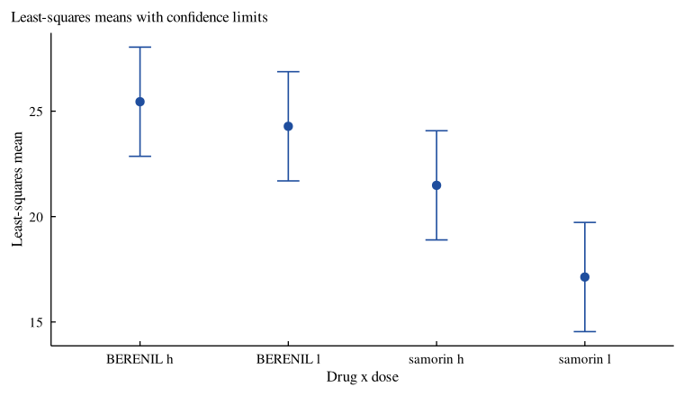

# VetResearchLMM: Linear Mixed Models with Applications in Veterinary
Research


[](https://CRAN.R-project.org/package=VetResearchLMM)
[](https://cran.r-project.org/web/checks/check_results_VetResearchLMM.html)
[](https://CRAN.R-project.org/package=VetResearchLMM)
[](https://CRAN.R-project.org/package=VetResearchLMM)
[](https://myaseen208.r-universe.dev/VetResearchLMM)
[](https://github.com/myaseen208/VetResearchLMM/actions/workflows/R-CMD-check.yml)
[](https://github.com/myaseen208/VetResearchLMM)
[](https://cran.r-project.org/)
[](https://CRAN.R-project.org/package=VetResearchLMM)
[](https://www.gnu.org/licenses/old-licenses/gpl-2.0.html)
[](https://www.repostatus.org/#active)
[](https://github.com/myaseen208/VetResearchLMM/commits)

## Overview

**VetResearchLMM** gives the data sets and every analysis of Duchateau,
Janssen and Rowlands (1998), *Linear Mixed Models. An Introduction with
Applications in Veterinary Research* (ILRI, Nairobi), with its own
engine for linear mixed models that gives the results the book prints
from SAS PROC MIXED and PROC GLM.

- `vlm_fit()`: REML, ML or Type 3 (moment) estimation; random variance
  components, random coefficients (`vlm_random()`, VC or UN) and
  residual structures (`vlm_repeated()`: CS, AR(1), SP(POW), UN); the
  fixed-effects solution in the overparameterised coding; Type 3 or Type
  1 tests with containment, residual, between-within, Satterthwaite or
  Kenward-Roger degrees of freedom; fit statistics;
- `vlm_lsmeans()`, `vlm_estimate()`, `vlm_contrast()`: least-squares
  means with Tukey, Bonferroni or Sidak comparisons, estimates in the
  broad and narrow inference spaces, and F tests of contrasts;
- `vlm_blup()`: best linear unbiased predictions of random effects;
- `vlm_ems()`: the analysis of variance with expected mean squares and
  synthesised F tests;
- `vlm_compare()`: information criteria and likelihood ratio tests of
  covariance structures;
- `vlm_interpret()`, `vlm_cite()`, `vlm_app()`: plain-language
  interpretation, references and a shiny application in which every
  example of the book loads with one click.

The help pages `?Examp1.3.2` to `?Examp3.3` give the SAS program of each
example with the same analysis in R. The package reproduces 115 of the
116 numbers of the book that it checks; the other one is printed
truncated (3.685 for 3.6855). Version 2.0.0 keeps the data sets, the
help topics and `emmeans_mixed_model()` and `report_mixed_model()` of
version 1.1.0, adds the data sets of Examples 1.2.2, 1.2.3 and 1.2.6,
and corrects three typing errors in `ex33`.

## Installation

``` r
install.packages("VetResearchLMM")
# development version
# install.packages("remotes")
remotes::install_github("myaseen208/VetResearchLMM")
```

## Quick start

The split-plot experiment of Example 1.2.5 (drugs given to herds within
regions, doses to animals within herds):

``` r
library(VetResearchLMM)
fm <-
  vlm_fit(
      fixed    = Pcv ~ Drug + dose + Drug:dose
    , data     = ex125
    , random   = ~ Region + Region:Drug
    , repeated = NULL
    , method   = c("REML", "ML", "Type3")
    , ddfm     = "satterth"
    , type     = 3
    , class    = NULL
    , bound    = TRUE
    , control  = list()
    )
fm
```

    Linear mixed model: Pcv ~ Drug + dose + Drug:dose
    Estimation: REML; denominator df: satterth; converged after 6 iterations
    Random: Region; Region:Drug

    Covariance parameter estimates
       parameter subject estimate     se      z      p
          Region            5.151  3.739  1.378 0.0842
     Region:Drug           0.3870  1.022 0.3788 0.3524
        Residual            2.096 0.9375  2.236 0.0127

    Fit statistics
                    statistic   value
        -2 Res Log Likelihood 92.3786
      AIC (smaller is better) 98.3786
     AICC (smaller is better) 99.8786
      BIC (smaller is better) 101.366

    Solution for fixed effects
          effect     level estimate     se    df      t        p
     (Intercept)              17.13  1.128 8.208  15.19  < 1e-04
            Drug   BERENIL    7.150 0.9098 11.82  7.859  < 1e-04
            Drug   samorin        0                            .
            dose         h    4.350 0.8359 10.00  5.204 0.000399
            dose         l        0                            .
       Drug:dose BERENIL h   -3.183  1.182 10.00 -2.693 0.022594
       Drug:dose BERENIL l        0                            .
       Drug:dose samorin h        0                            .
       Drug:dose samorin l        0                            .

    Type 3 tests of fixed effects
        effect num_df den_df     F        p
          Drug      1  5.000 64.58 0.000483
          dose      1  10.00 21.78 0.000886
     Drug:dose      1  10.00 7.251 0.022594

    Sources: Duchateau, Janssen and Rowlands (1998); Patterson and Thompson (1971);
    Gilmour, Thompson and Cullis (1995); Littell, Milliken, Stroup and Wolfinger
    (1996); Satterthwaite (1946); Giesbrecht and Burns (1985); Fai and Cornelius
    (1996). Full references: vlm_cite(x).

``` r
vlm_interpret(
    x     = fm
  , alpha = 0.05
  , top   = 3L
  )
```

    Linear mixed model

    Pcv ~ Drug + dose + Drug:dose, fitted by REML with 3 covariance parameters.

    Findings:
    - Of the total variance 7.63, 67.5% is due to Region, 5.1% is due to
      Region:Drug, 27.5% is due to the residual (within) variation.
    - Significant at the 0.05 level: Drug (F = 64.6 on 1 and 5 df, p = 0.00048);
      dose (F = 21.8 on 1 and 10 df, p = 0.00089); Drug:dose (F = 7.25 on 1 and
      10 df, p = 0.023).

    Recommendations:
    - The interaction Drug:dose is significant: compare the levels of one factor
      within each level of the other (vlm_lsmeans() of the interaction, or
      vlm_estimate()) rather than main-effect means.
    - Report means with standard errors in the broad inference space
      (vlm_lsmeans()); use vlm_estimate() with `random` for the narrow space of
      the observed levels.

    Sources:
    - Duchateau, L., Janssen, P. and Rowlands, G. J. (1998). Linear Mixed Models.
      An Introduction with Applications in Veterinary Research. International
      Livestock Research Institute, Nairobi. ISBN 92-9146-038-9.
    - Patterson, H. D. and Thompson, R. (1971). Recovery of inter-block
      information when block sizes are unequal. Biometrika, 58(3), 545-554.
      doi:10.1093/biomet/58.3.545
    - Gilmour, A. R., Thompson, R. and Cullis, B. R. (1995). Average information
      REML: an efficient algorithm for variance parameter estimation in linear
      mixed models. Biometrics, 51(4), 1440-1450. doi:10.2307/2533274
    - Littell, R. C., Milliken, G. A., Stroup, W. W. and Wolfinger, R. D. (1996).
      SAS System for Mixed Models. SAS Institute, Cary, NC.
    - Satterthwaite, F. E. (1946). An approximate distribution of estimates of
      variance components. Biometrics Bulletin, 2(6), 110-114.
      doi:10.2307/3002019
    - Giesbrecht, F. G. and Burns, J. C. (1985). Two-stage analysis based on a
      mixed model: large-sample asymptotic theory and small-sample simulation
      results. Biometrics, 41(2), 477-486. doi:10.2307/2530872
    - Fai, A. H.-T. and Cornelius, P. L. (1996). Approximate F-tests of multiple
      degree of freedom hypotheses in generalized least squares analyses of
      unbalanced split-plot experiments. Journal of Statistical Computation and
      Simulation, 54(4), 363-378. doi:10.1080/00949659608811740

``` r
lm1 <-
  vlm_lsmeans(
      fit    = fm
    , specs  = ~ Drug:dose
    , at     = NULL
    , diff   = TRUE
    , adjust = "tukey"
    , level  = 0.95
    )
plot(x = lm1)
```



## Learn more

- Vignettes: `browseVignettes("VetResearchLMM")`, starting with
  `VetResearchLMM_01_getting_started`; PDF versions on the site.
- Site: <https://myaseen208.com/VetResearchLMM/>
- Notation: `vlm_notation()`
- References of the methods behind a result: `vlm_cite()`

## Citation

    Yaseen M, Duchateau L, Janssen P, Rowlands J (2026). _VetResearchLMM:
    Linear Mixed Models: An Introduction with Applications in Veterinary
    Research_. R package version 2.0.0,
    <https://CRAN.R-project.org/package=VetResearchLMM>.

BibTeX:

    @Manual{VetResearchLMM,
      title = {{VetResearchLMM}: Linear Mixed Models: An Introduction with Applications in Veterinary Research},
      author = {Muhammad Yaseen and Luc Duchateau and Paul Janssen and John Rowlands},
      year = {2026},
      note = {R package version 2.0.0},
      url = {https://CRAN.R-project.org/package=VetResearchLMM},
    }

Please also cite the book: `citation("VetResearchLMM")` lists it with
the package, and `vlm_cite(x)` gives the references of a single result.
