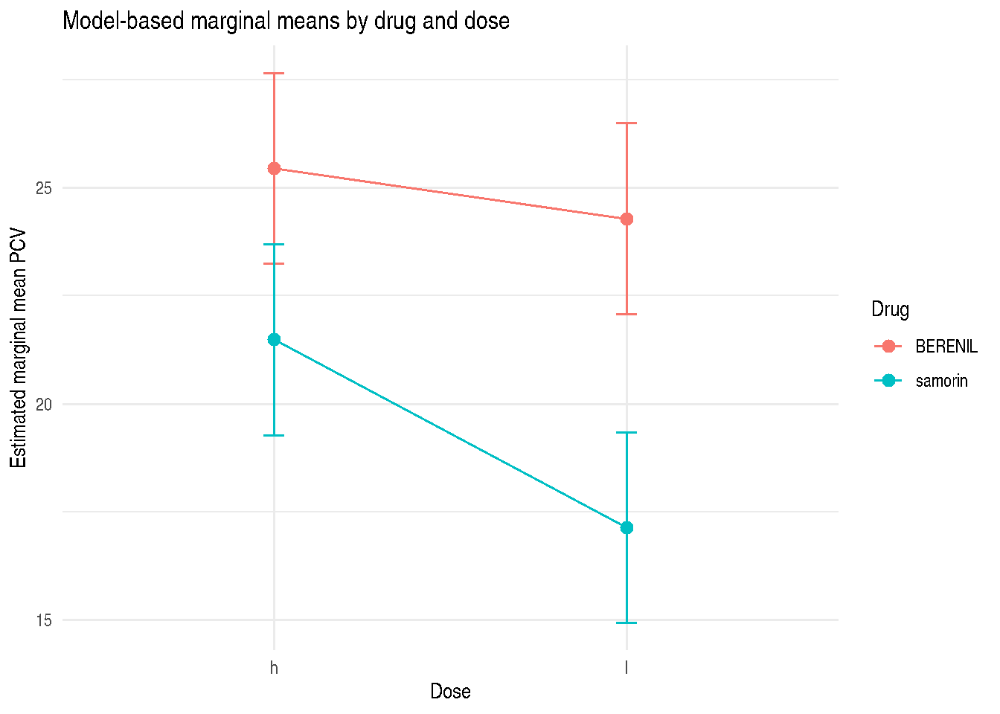

# Book Examples in R

## 1 Chapter and Example Map

The package implements the following book examples as help pages:

| Package page | Book page | Dataset | Main analysis |
|----|---:|----|----|
| `Examp1.3.2` | 16 | `ex124` | fixed effect ANOVA with split-plot structure |
| `Examp2.2.1.7` | 42 | `ex121` | dose hypothesis test |
| `Examp2.4.2.2` | 64 | `ex125` | ML and REML variance components |
| `Examp2.4.3.1` | 66 | `ex127` | BLUPs for sire effects |
| `Examp2.5.1.1` | 67 | `ex125` | fixed effect estimates |
| `Examp2.5.2.1` | 68 | `ex125` | linear combinations of fixed effects |
| `Examp2.5.3.1` | 70 | `ex125` | confidence intervals |
| `Examp2.5.4.1` | 74 | `ex125` | fixed versus mixed model intervals |
| `Examp2.6.1` | 76 | `ex125` | fixed effect hypothesis tests |
| `Examp3.1` | 80, 84, 86 | `ex31` | three PCV response models |
| `Examp3.2` | 88 | `ex32` | weaning weight mixed model |
| `Examp3.3` | 88 onward | `ex33` | longitudinal PCV mixed models |

## 2 Example 2.4.3.1

The sire random-effect example estimates a sire variance component and
predicts sire effects.

``` r

if (requireNamespace("lme4", quietly = TRUE)) {
  sire_fit <- lme4::lmer(Ww ~ 1 + (1 | sire), data = ex127, REML = TRUE)
  if (requireNamespace("report", quietly = TRUE)) {
    report::report(sire_fit)
  }

  lme4::fixef(sire_fit)
  as.data.frame(lme4::VarCorr(sire_fit))
  head(lme4::ranef(sire_fit)$sire)
}
```

      (Intercept)
    1  -2.1979037
    2  -0.0318874
    3  -1.7434719
    4   3.1587811
    5   0.8691909
    6  -0.8627975

The readable book targets are reproduced to rounding: mean near `13.97`,
sire variance near `3.685`, residual variance near `3.542`, and sire 4
BLUP near `3.16`.

## 3 Example 2.6.1

The contrast for the Samorin versus Berenil comparison can be expressed
against the fitted fixed-effect vector.

``` r

if (requireNamespace("lmerTest", quietly = TRUE)) {
  contrast_fit <- lmerTest::lmer(
    Pcv ~ dose * Drug + (1 | Region / Drug),
    data = ex125,
    REML = TRUE,
    contrasts = list(dose = "contr.SAS", Drug = "contr.SAS")
  )
  if (requireNamespace("report", quietly = TRUE)) {
    report::report(contrast_fit)
  }

  contrast <- matrix(
    c(0, 0, -1, -0.5),
    ncol = 4,
    dimnames = list("drug_difference", rownames(summary(contrast_fit)$coef))
  )

  lmerTest::contest(contrast_fit, contrast, joint = FALSE)
}
```

                     Estimate Std. Error df   t value     lower     upper
    drug_difference -5.558333  0.6916667  5 -8.036145 -7.336319 -3.780348
                        Pr(>|t|)
    drug_difference 0.0004825951

The estimate and variance match the readable book values (`-5.55` and
about `0.478`). The p-value printed by current R is based on the same F
statistic but can differ from the book because of software and reporting
differences.

## 4 Post Hoc Inference with emmeans

After fitting a mixed model, `report` and `emmeans` provide
complementary interpretations. `report` gives a narrative summary of the
model object, while `emmeans` gives estimated marginal means, contrasts,
and post hoc comparisons. For the split-plot example, the marginal means
can be computed for dose within drug. The package helper
[`emmeans_mixed_model()`](https://myaseen208.com/VetResearchLMM/reference/emmeans_mixed_model.md)
returns these same marginal means or pairwise contrasts through a
guarded package-level API.

``` r

if (requireNamespace("emmeans", quietly = TRUE) && exists("contrast_fit")) {
  example_emm <- emmeans::emmeans(
    contrast_fit,
    ~ dose | Drug,
    lmer.df = "asymptotic"
  )
  example_pairs <- emmeans::contrast(example_emm, method = "pairwise")

  as.data.frame(example_emm)
} else {
  data.frame(
    workflow = "Optional marginal means",
    requirement = "Install emmeans to compute estimated marginal means"
  )
}
```

    Drug = BERENIL:
     dose   emmean       SE  df asymp.LCL asymp.UCL
     h    25.45000 1.127996 Inf  23.23917  27.66083
     l    24.28333 1.127996 Inf  22.07250  26.49416

    Drug = samorin:
     dose   emmean       SE  df asymp.LCL asymp.UCL
     h    21.48333 1.127996 Inf  19.27250  23.69417
     l    17.13333 1.127996 Inf  14.92250  19.34417

    Degrees-of-freedom method: asymptotic
    Confidence level used: 0.95 

``` r

if (exists("example_pairs")) {
  as.data.frame(example_pairs)
}
```

    Drug = BERENIL:
     contrast estimate       SE  df z.ratio p.value
     h - l    1.166667 0.835946 Inf   1.396  0.1628

    Drug = samorin:
     contrast estimate       SE  df z.ratio p.value
     h - l    4.350000 0.835946 Inf   5.204 <0.0001

    Degrees-of-freedom method: asymptotic 

``` r

if (exists("example_emm") && requireNamespace("ggplot2", quietly = TRUE)) {
  example_emm_df <- as.data.frame(example_emm)
  lower_ci <- intersect(c("lower.CL", "asymp.LCL"), names(example_emm_df))[1L]
  upper_ci <- intersect(c("upper.CL", "asymp.UCL"), names(example_emm_df))[1L]
  example_emm_df$lower_ci <- example_emm_df[[lower_ci]]
  example_emm_df$upper_ci <- example_emm_df[[upper_ci]]

  ggplot2::ggplot(
    example_emm_df,
    ggplot2::aes(x = dose, y = emmean, color = Drug, group = Drug)
  ) +
    ggplot2::geom_line(linewidth = 0.6) +
    ggplot2::geom_point(size = 2.4) +
    ggplot2::geom_errorbar(
      ggplot2::aes(ymin = lower_ci, ymax = upper_ci),
      width = 0.06,
      linewidth = 0.5
    ) +
    ggplot2::labs(
      x = "Dose",
      y = "Estimated marginal mean PCV",
      color = "Drug",
      title = "Model-based marginal means by drug and dose"
    ) +
    ggplot2::theme_minimal()
}
```



## 5 Modern Preprocessing Pattern

Several book examples require factor versions of design columns or
indicator variables for contrasts. The package examples use a single
[`collapse::fmutate()`](https://fastverse.org/collapse/reference/ftransform.html)
step so that these derived variables are readable and reproducible.

``` r

ex31_prepared <-
  ex31 |>
  collapse::fmutate(
    herd1 = factor(herd),
    drug1 = factor(drug),
    dose1 = factor(dose),
    ber = as.integer(drug == "BERENIL"),
    ber1 = as.integer(drug == "BERENIL" & dose == 1L),
    pcv_ber1 = PCV1 * as.integer(drug == "BERENIL" & dose == 1L),
    pcv_ber2 = PCV1 * as.integer(drug == "BERENIL" & dose == 2L)
  )

head(ex31_prepared)
```

      herd animal_id PCV1 PCV2 dose    drug herd1   drug1 dose1 ber ber1 pcv_ber1
    1    1       667   17   28    1 BERENIL     1 BERENIL     1   1    1       17
    2    1      1003   22   23    1 BERENIL     1 BERENIL     1   1    1       22
    3    1      1177   20   28    1 BERENIL     1 BERENIL     1   1    1       20
    4    1       227   22   25    2 BERENIL     1 BERENIL     2   1    0        0
    5    1       241   22   23    2 BERENIL     1 BERENIL     2   1    0        0
    6    1       271   18   18    2 BERENIL     1 BERENIL     2   1    0        0
      pcv_ber2
    1        0
    2        0
    3        0
    4       22
    5       22
    6       18

## 6 Example 3.1

Example 3.1 fits increasingly rich models for packed cell volume one
month after treatment. The current package data contain 38 observations,
while the book page image for Model 3 shows denominator degrees of
freedom greater than 300. That indicates the printed SAS output and the
packaged data are not at the same observational granularity for that
table. The package therefore verifies the R code logically and
statistically but does not claim exact numerical agreement for the Model
3 printed table.
