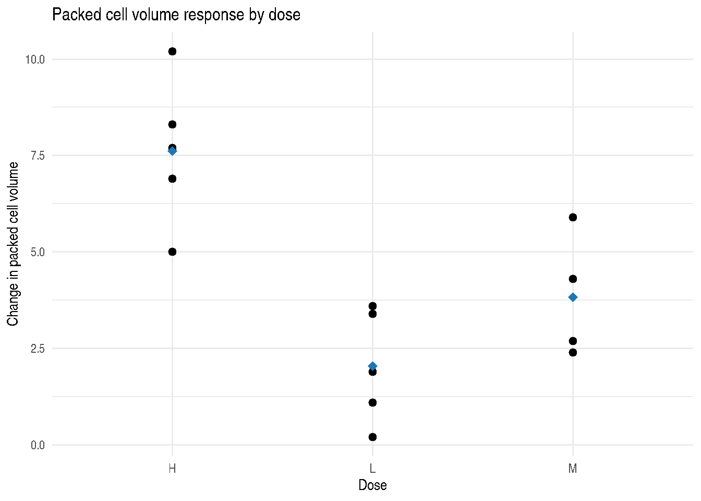

# Introduction to VetResearchLMM

## 1 Scope

`VetResearchLMM` contains datasets and R examples for Duchateau,
Janssen, and Rowlands (1998), *Linear Mixed Models: An Introduction with
Applications in Veterinary Research*. The package is designed for
applied users who want to work through the book examples in R while
preserving the statistical intent of the original SAS analyses.

The package does not define a large modelling API. Instead, it provides:

- book datasets in `data/`
- example help pages such as
  [`?Examp2.4.2.2`](https://myaseen208.com/VetResearchLMM/reference/Examp2.4.2.2.md)
- [`collapse::fmutate()`](https://fastverse.org/collapse/reference/ftransform.html)
  preprocessing patterns in modernized examples
- [`report_mixed_model()`](https://myaseen208.com/VetResearchLMM/reference/report_mixed_model.md)
  for optional easystats-style fitted model reports
- tests that guard the documented dataset structure
- regression checks for readable numerical targets from the book

Current package maintenance includes the School of Mathematical and
Statistical Sciences, Clemson University.

## 2 Included Data

``` r

data.frame(
  dataset = c("ex121", "ex124", "ex125", "ex127", "ex31", "ex32", "ex33"),
  rows = c(
    nrow(ex121), nrow(ex124), nrow(ex125), nrow(ex127),
    nrow(ex31), nrow(ex32), nrow(ex33)
  ),
  columns = c(
    ncol(ex121), ncol(ex124), ncol(ex125), ncol(ex127),
    ncol(ex31), ncol(ex32), ncol(ex33)
  )
)
```

      dataset rows columns
    1   ex121   14       5
    2   ex124   40       4
    3   ex125   24       4
    4   ex127   43       2
    5    ex31   38       6
    6    ex32   65       5
    7    ex33  168       4

## 3 Working With an Example

Example 2.2.1.7 studies hypothesis testing for dose effects in the
`ex121` data. The book reports an F statistic near 14.36 for the dose
effect. The R analysis reproduces that value to rounding precision.

``` r

fit_ex2217 <- stats::aov(PCVdiff ~ dose, data = ex121)
if (requireNamespace("report", quietly = TRUE)) {
  report::report(fit_ex2217)
}
```

    The ANOVA (formula: PCVdiff ~ dose) suggests that:

      - The main effect of dose is statistically significant and large (F(2, 11) =
    14.37, p < .001; Eta2 = 0.72, 95% CI [0.39, 1.00])

    Effect sizes were labelled following Field's (2013) recommendations.

``` r

stats::anova(fit_ex2217)
```

    Analysis of Variance Table

    Response: PCVdiff
              Df Sum Sq Mean Sq F value   Pr(>F)
    dose       2 80.727  40.363  14.365 0.000856 ***
    Residuals 11 30.908   2.810
    ---
    Signif. codes:  0 '***' 0.001 '**' 0.01 '*' 0.05 '.' 0.1 ' ' 1

The same dataset can be viewed graphically before modelling.

``` r

ggplot2::ggplot(ex121, ggplot2::aes(x = dose, y = PCVdiff)) +
  ggplot2::geom_point(size = 2) +
  ggplot2::stat_summary(
    fun = mean,
    geom = "point",
    size = 3,
    shape = 18,
    color = "#1f78b4"
  ) +
  ggplot2::labs(
    x = "Dose",
    y = "Change in packed cell volume",
    title = "Packed cell volume response by dose"
  ) +
  ggplot2::theme_minimal()
```



## 4 Book Verification Note

The bundled PDF is a scanned Google Books PDF with no extractable text.
Exact automated comparison against every printed value is therefore not
possible without OCR. The package tests verify the examples where the
printed targets are readable from page images, and the remaining
examples are checked by model specification and successful execution.
