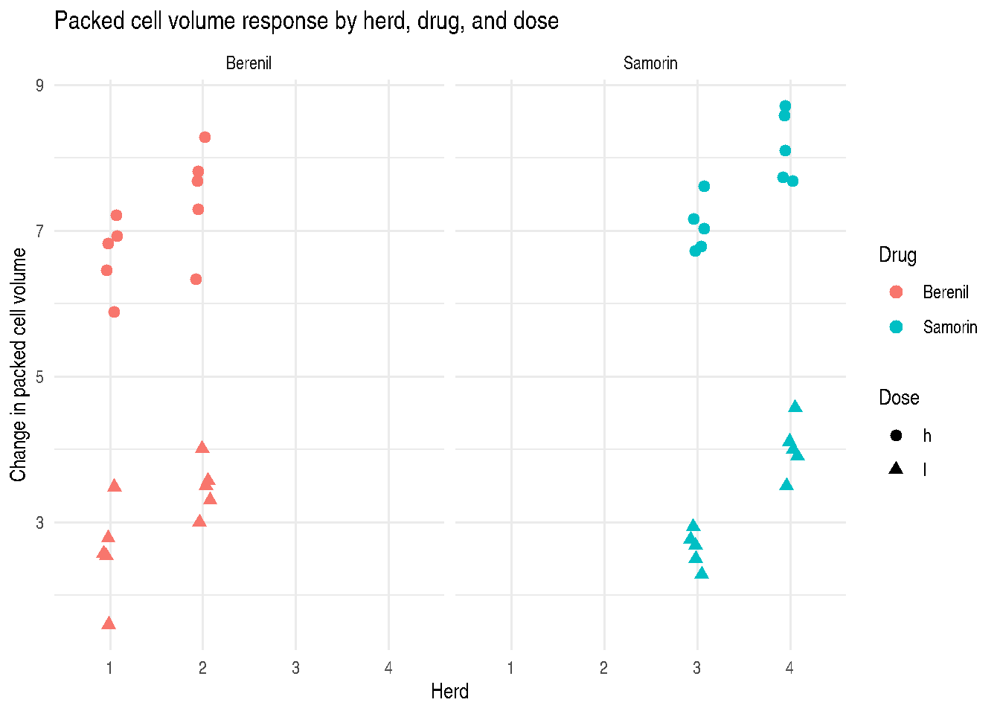
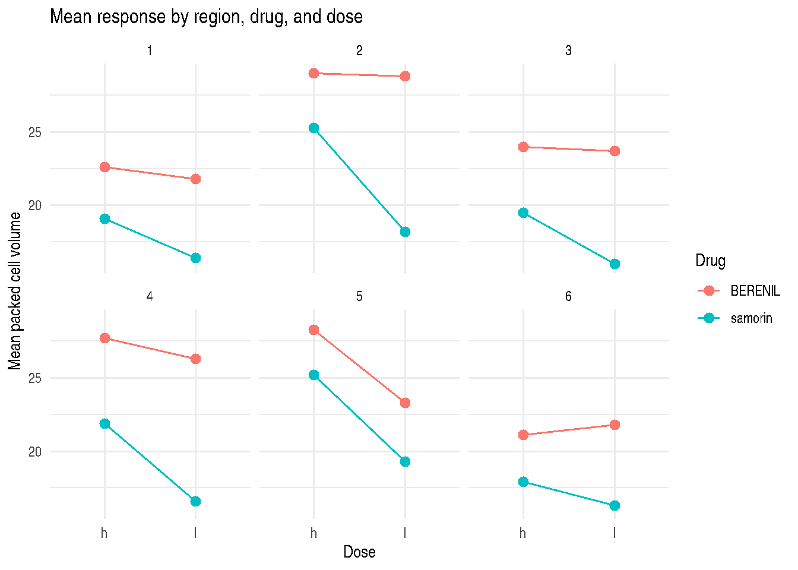
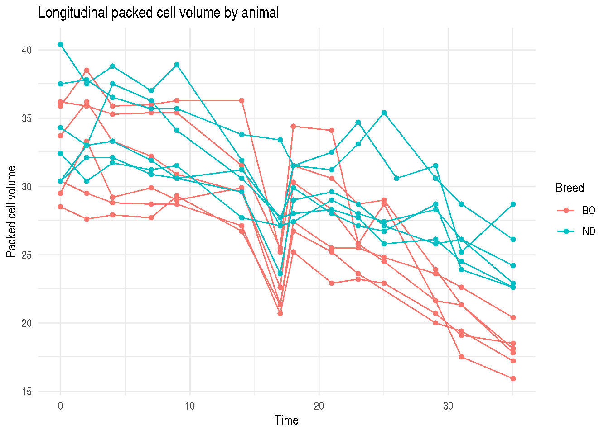
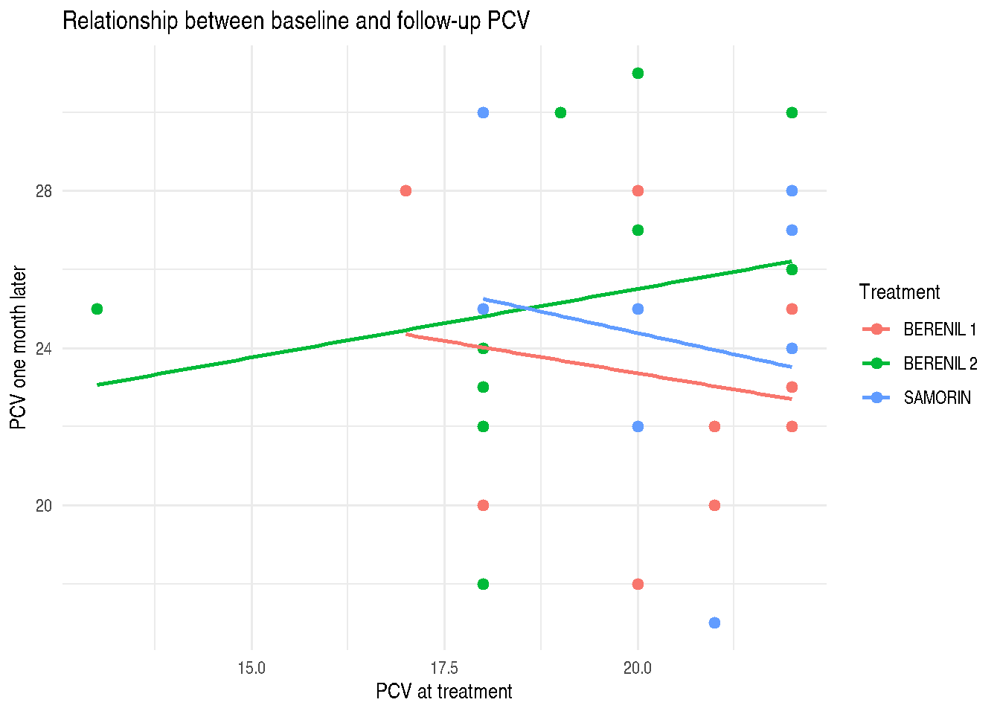

# Plotting the Veterinary Examples

## 1 Plotting Principles

The original book uses simple black-and-white plots. In R, `ggplot2` can
recreate the same scientific comparisons with clearer labels and
reproducible code. The goal is not decorative plotting; it is to show
design structure, grouping, and model implications.

## 2 Split-Plot Packed Cell Volume Data

``` r

ex124_plot <-
  ex124 |>
  collapse::fmutate(herd = factor(herd))

ggplot2::ggplot(
  ex124_plot,
  ggplot2::aes(x = herd, y = PCVdif, shape = dose, color = drug)
) +
  ggplot2::geom_point(size = 2.4, position = ggplot2::position_jitter(width = 0.08)) +
  ggplot2::facet_wrap(~ drug, nrow = 1) +
  ggplot2::labs(
    x = "Herd",
    y = "Change in packed cell volume",
    shape = "Dose",
    color = "Drug",
    title = "Packed cell volume response by herd, drug, and dose"
  ) +
  ggplot2::theme_minimal()
```



## 3 Region, Drug, and Dose Means

``` r

ggplot2::ggplot(
  ex125,
  ggplot2::aes(x = dose, y = Pcv, group = Drug, color = Drug)
) +
  ggplot2::stat_summary(fun = mean, geom = "line") +
  ggplot2::stat_summary(fun = mean, geom = "point", size = 2.6) +
  ggplot2::facet_wrap(~ Region) +
  ggplot2::labs(
    x = "Dose",
    y = "Mean packed cell volume",
    title = "Mean response by region, drug, and dose"
  ) +
  ggplot2::theme_minimal()
```



## 4 Longitudinal PCV Data

``` r

ggplot2::ggplot(
  ex33,
  ggplot2::aes(x = time, y = PCV, group = animal_id, color = breed)
) +
  ggplot2::geom_line(linewidth = 0.5) +
  ggplot2::geom_point(size = 1.4) +
  ggplot2::labs(
    x = "Time",
    y = "Packed cell volume",
    color = "Breed",
    title = "Longitudinal packed cell volume by animal"
  ) +
  ggplot2::theme_minimal()
```



## 5 Model-Based Lines for Example 3.1

The book displays fitted lines for Example 3.1 Model 3. The packaged
`ex31` data can be plotted with simple group-specific linear fits to
inspect the same relationship between baseline PCV and one-month PCV.

``` r

ex31_plot <-
  ex31 |>
  collapse::fmutate(
    treatment = ifelse(drug == "BERENIL", paste(drug, dose), as.character(drug))
  )

ggplot2::ggplot(
  ex31_plot,
  ggplot2::aes(x = PCV1, y = PCV2, color = treatment)
) +
  ggplot2::geom_point(size = 2) +
  ggplot2::geom_smooth(method = "lm", se = FALSE, linewidth = 0.8) +
  ggplot2::labs(
    x = "PCV at treatment",
    y = "PCV one month later",
    color = "Treatment",
    title = "Relationship between baseline and follow-up PCV"
  ) +
  ggplot2::theme_minimal()
```


